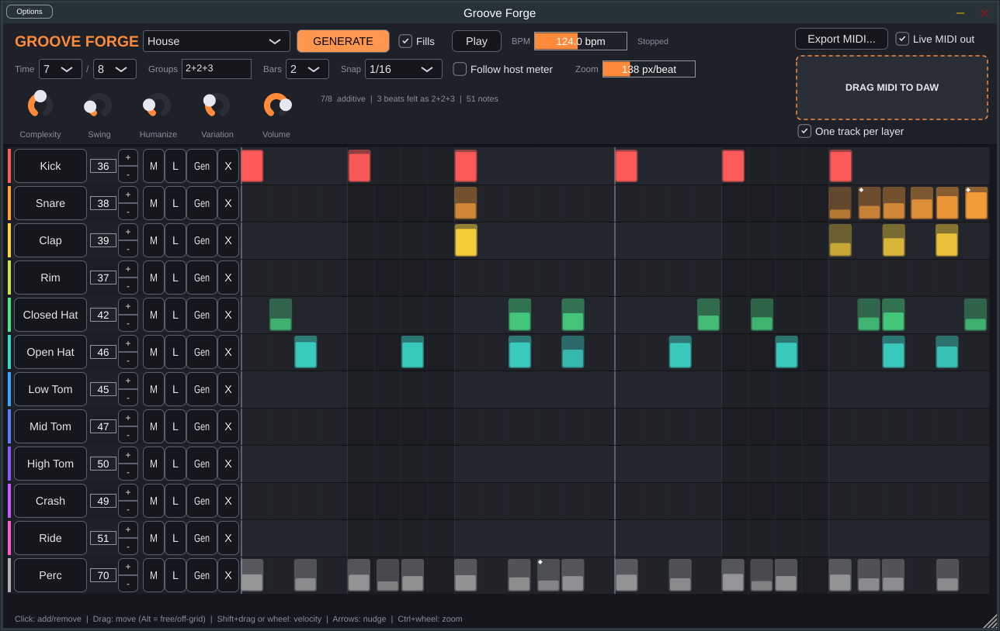

# Groove Forge



A drum machine plug-in (VST3 / AU / Standalone) built with JUCE. It combines a
step sequencer with off-grid, piano-roll-style note placement, and includes a
genre-aware pattern generator that understands time signatures.

## Features

- **Step-sequencer grid that can go off grid.** There is one row per drum layer,
  like a classic step sequencer. Notes are stored at exact positions, so you can
  snap to 1/4 … 1/64 or triplets, or set *Snap: Off* (or hold **Alt** while
  dragging) to place hits anywhere. Notes that sit clearly between 16ths get a
  small ◆ marker.
- **12 layers:** Kick, Snare, Clap, Rim, Closed Hat, Open Hat, Low/Mid/High Tom,
  Crash, Ride and Perc. Each layer has:
  - **M**: mute (muted layers are also left out of exports)
  - **L**: lock (*Generate* leaves the layer alone)
  - **Gen**: regenerate only this layer
  - **X**: clear the layer
  - a MIDI note number (General MIDI drum map by default)
- **Genre generator** with 16 styles: House, Techno, Hip-Hop/Boom Bap, Trap,
  Drum & Bass, Breakbeat, Rock, Metal, Funk, Reggae (One Drop), Afrobeat,
  Latin/Bossa, Jazz Swing, Dubstep, Reggaeton, UK Garage.
  - *Complexity* controls density (ghost notes, syncopated kicks, extra
    percussion).
  - *Swing* ranges from 50 % (straight) to 75 %.
  - *Humanize* adds timing and velocity drift on top of each genre's own feel
    (for example, the boom-bap snare sits slightly late).
  - *Variation* sets how much bars differ from each other.
  - *Fills* adds a tom fill, snare roll or hat roll (depending on the genre) at
    the end of the pattern.
  - Trap hat rolls and jazz ride "skip" notes use real triplets and 32nds, so
    they also land off the 16th grid.
- **Real odd-meter generation.** The generator does not cut a 4/4 bar short.
  It analyses the meter into felt beats and accent groups and writes each genre
  against that structure:

  | Meter | Default grouping | How it is played |
  |-------|------------------|------------------|
  | 4/4   | 2+2              | backbeats on 2 and 4 |
  | 3/4   | 3                | backbeat on 3, waltz ride |
  | 5/4   | 3+2              | backbeats on 3 and 5 |
  | 6/8, 9/8, 12/8 | 3+3(+3…) | compound: dotted-quarter pulse, backbeat on the 2nd/4th pulse |
  | 7/8   | 2+2+3            | three uneven beats; the snare lands on the long beat |
  | 5/8, 11/8, 13/8 … | 3+2, 3+3+3+2 … | additive meters |

  You can type your own grouping in the *Groups* field (for example `3+3+2` for
  8/8 or `2+2+2+3` for 9/8) and press Enter. *Follow host meter* switches the
  time signature automatically when your DAW reports a different one.
- **Getting the pattern into the DAW:**
  1. **Drag MIDI to DAW:** drag the pad onto a track or the arrangement to drop
     the pattern as a `.mid` clip.
  2. **Export MIDI…:** save a Standard MIDI File (960 PPQ, channel 10, with
     tempo and time-signature events). With *One track per layer* turned on,
     each drum layer gets its own named track.
  3. **Live MIDI out:** while the host plays, the plug-in sends the pattern as
     MIDI. You can route it to another drum instrument or record it.
- A **built-in synthesized kit** makes it playable on its own. Incoming MIDI
  notes also trigger the kit.

## Editing

| Action | Result |
|--------|--------|
| Click an empty cell | add a note (keep holding and drag to place it) |
| Click a note | remove it (step-sequencer toggle) |
| Drag a note | move it (snapped; **Alt** = free / off-grid) |
| Shift + drag, or mouse wheel over a note | change velocity |
| ← / → | nudge the selected note by 1/128 beat (Shift: by the snap value) |
| ↑ / ↓ | change the selected note's velocity |
| Delete / Backspace, right-click | delete |
| Ctrl/Cmd + wheel, or the Zoom bar | zoom horizontally |

## Building

You need CMake 3.22 or newer and a C++17 compiler. On Linux you also need the
packages listed in `docs/Linux Dependencies.md`.

```sh
cd /path/to/JUCE
cmake -S GrooveForge -B build-gf -DCMAKE_BUILD_TYPE=Release
cmake --build build-gf --config Release
```

The build writes the plug-ins to
`build-gf/GrooveForge_artefacts/Release/{VST3,AU,Standalone}`. Copy the
`.vst3` (or `.component` on macOS) into your plug-in folder, or set
`COPY_PLUGIN_AFTER_BUILD TRUE` in `CMakeLists.txt`.

Tests:

```sh
build-gf/GrooveForgeGenTest_artefacts/Release/GrooveForgeGenTest            # prints every genre in 4/4 and 7/8 as ASCII grids
build-gf/GrooveForgeProcessorTest_artefacts/Release/GrooveForgeProcessorTest  # checks MIDI timing/looping against a fake host
```

## Licensing

Groove Forge is built on the JUCE framework. JUCE is dual-licensed under the
AGPLv3 and the commercial JUCE licence (see `../LICENSE.md`). If you distribute
this plug-in under terms other than the AGPLv3, for example as closed-source or
commercial software, you need a commercial JUCE licence. VST3 builds are also
subject to Steinberg's VST3 SDK licence.
