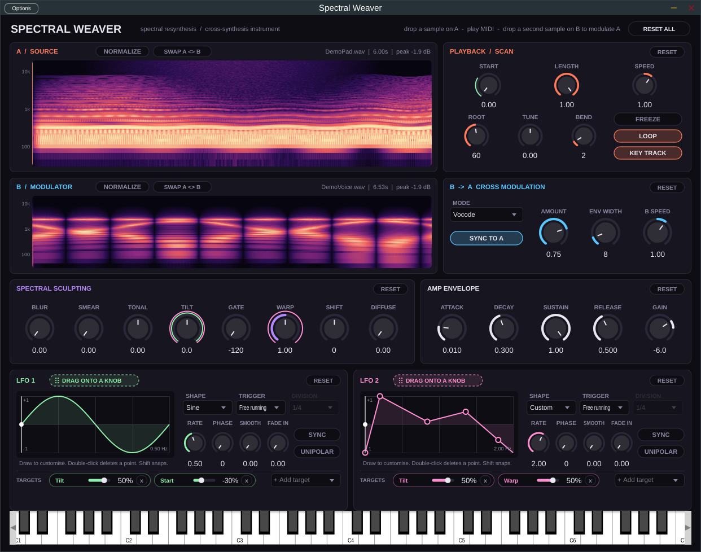

# Spectral Weaver

A JUCE instrument plug-in (VST3 / AU / Standalone). It takes a sample apart
into its **spectral image**, which is the magnitude and true frequency of every
STFT bin in every frame. It then resynthesises that image as a playable,
polyphonic sound source. Drop a **second sample** on slot B and it reshapes the
first one with its own spectrum.

## How it works

1. **Analysis** (background thread, on drop): the file is decoded, mixed to mono,
   resampled to 48 kHz and its peak level measured. A 2048-point Hann STFT with 75 % overlap
   measures each bin's magnitude and its instantaneous frequency (from the
   phase difference between frames). The result is shown as a log-frequency
   spectrogram.
2. **Resynthesis** (per voice, 8 voices): a playhead scans through the image at
   any speed or direction, or freezes on one moment. Each hop, the frame passes
   through the cross-modulation and sculpting stages. Its bins are then moved
   to the played pitch and rebuilt with a phase vocoder that uses identity
   phase locking, so partials stay clean.

## Controls

| Section | Controls |
|---|---|
| **Playback / Scan** | Start, Length (scan region, shown on the spectrogram), Speed (−4x … 4x, negative = reverse), Freeze (scrub with Start), Loop, Root note, Tune, Pitch-bend range, Key Track |
| **B → A Cross Modulation** | **Vocode**: A's fine structure wearing B's spectral envelope. **Multiply**: A filtered by B, bin by bin. **Morph**: geometric interpolation of the two images. **Mask**: B's energy gates A's bins. **Imprint**: B's harmonics/pitch coloured by A's envelope. Plus Amount (the mod wheel adds to it), Envelope Width, Sync to A (B follows A's playhead) or a free-running B Speed |
| **Spectral Sculpting** | Blur (temporal smoothing), Smear (frequency smoothing), Tonal (+ keeps only spectral peaks, − keeps only the residual noise), Tilt (dB/oct), Gate (drop bins below a threshold), Warp (inharmonic frequency stretch), Shift (linear Hz shift), Diffuse (phase randomisation) |
| **LFO 1 & 2** | Shape (sine, triangle, saw up/down, square, random S&H, smooth random, or a custom shape you draw), Rate or tempo-synced Division (locks to the host song position while playing), Phase, Smooth, Fade In, free-running or retrigger on each note, unipolar or bipolar |
| **Amp** | ADSR, Gain |

To load a sample, drag an audio file (WAV/AIFF/FLAC/OGG/MP3, up to 60 s) onto
a spectrogram or click it to browse. Right-click a spectrogram to clear it.
File paths are saved with the session.

Each sample keeps its original level. **Normalize** (on each sample) raises or
lowers it so its peak sits at 0 dB, and **Swap A <> B** exchanges the two
samples; the Normalize setting moves with its sample.

### Modulation

Each LFO can drive any number of knobs, and one knob can take both LFOs. There
are two ways to route an LFO:

- Drag the LFO's **Drag onto a knob** handle onto a knob.
- Pick a knob from the LFO's **+ Add target** menu.

Each routed knob appears in the LFO's target list with a depth slider, from
-100 % to +100 % of the knob's travel (negative depths invert the LFO). Click x
to remove a target. Coloured rings on a knob show each LFO's range, and a white
dot shows the live modulated value. Every depth is an automatable parameter
("LFO 1 > Tilt" and so on). The modulatable knobs are Start, Length, Speed,
Tune, Cross Amount, Env Width, B Speed, the eight sculpting controls, Sustain
and Gain.

To make a custom shape, click or drag on an LFO's shape display. Drawing on a
built-in shape turns it into an editable copy. Double-click a point to delete
it, and hold Shift to snap to the grid. Custom shapes and routes are saved with
the session. An LFO's **Reset** button restores its settings, removes its
targets and brings back the default custom shape.

To reset, double-click a knob to return just that knob to its default. Every
section has a **Reset** button for that section, and **Reset All** in the
header resets every knob, switch and menu. The samples and their Normalize
settings are not affected.

## Building

From this directory (it uses the JUCE checkout two levels up):

    cmake -B build -DCMAKE_BUILD_TYPE=Release
    cmake --build build --config Release

The VST3, AU (macOS) and Standalone app are written to
`build/SpectralWeaver_artefacts/Release/`. On Linux, first install the packages
listed in `docs/Linux Dependencies.md`.

### DSP tests

    cmake -B build -DSPECTRAL_WEAVER_BUILD_TESTS=ON
    cmake --build build --target SpectralWeaverTests
    ./build/SpectralWeaverTests_artefacts/Release/SpectralWeaverTests

These check analysis accuracy, resynthesis pitch and level across sample
rates, key tracking, extreme settings and every cross-modulation mode.

## Licensing

This plug-in is built on the JUCE framework, which is dual-licensed under the
AGPLv3 and the commercial JUCE licence (see `../../LICENSE.md`). If you
distribute this plug-in without releasing its source under the AGPLv3, for
example as a closed-source commercial product, you need a commercial JUCE
licence.
