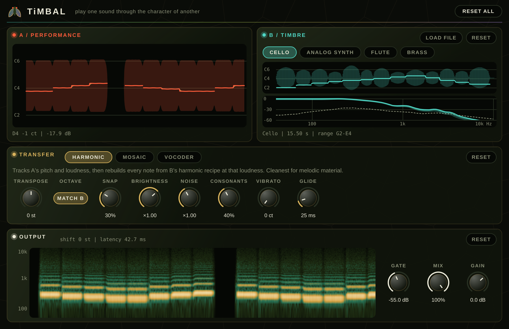

# TiMBAL



Part of **Cicada System**. A JUCE effect plug-in (VST3 / AU / Standalone)
that plays the performance of one sound through the character of another.
Sing, hum, whistle or beatbox into it (**A**, the live input) and it comes out
as a cello, a synth, a flute or any recording you give it (**B**, the timbre).

The name comes from the **tymbal**, the ribbed membrane a cicada buckles to
sing; its hollow body then shapes the colour of that sound. TiMBAL does the
same thing: your performance makes the sound, B gives it its body. The lower
case *i* nods to *timbre*.

Cicada System plug-ins are named after a part of the cicada's body or life
cycle, and share the Cicada look (`projects/shared/cicada_ui`).

## How it works

1. **Learning the timbre** (background thread, when B changes): the clip is
   mixed to mono, resampled to the session rate and analysed with a 46 ms Hann STFT
   (75 % overlap). A YIN pitch tracker finds its notes. For every pitched frame
   the harmonic amplitudes are measured and turned into an envelope over
   frequency, averaged separately for soft, medium and loud playing, so the
   plug-in learns how B brightens when it is played harder. It also measures
   B's noise floor (bow, breath) and how much of B's energy is noise.
2. **Listening to A** (audio thread, every 11 ms): loudness, pitch (YIN on a
   decimated copy), voicing and spectral centroid of the live input.
3. **Playing A through B**, one of three methods:

| Method | What it does | Best for |
|---|---|---|
| **Harmonic** | Rebuilds every note of A with up to 64 harmonics shaped by B's envelope at A's current loudness, plus B's noise. Unpitched sounds (hi-hats, "s") come out as noise in a mix of B's and their own colour. | Melodic input: voice, whistle, hummed lines |
| **Mosaic** | For each moment of A picks the fragment of B that best matches its loudness, brightness and pitch, retunes it and overlap-adds it. | Keeping B's real texture |
| **Vocoder** | Imprints A's spectral envelope on B's spectrum, frame by frame. B keeps its own notes; A supplies rhythm and articulation. | Rhythmic input, beatbox, speech |

Latency is one analysis frame (2048 samples at 44.1 / 48 kHz, about 43 ms) and
is reported to the host, so playback stays aligned. Live monitoring through
the plug-in hears that delay.

## Controls

| Section | Controls |
|---|---|
| **B / Timbre** | Built-in Cello, Analog synth, Flute, Brass (synthesised stand-ins), **Load file** or drop a WAV / AIFF / FLAC / OGG / MP3 (up to 30 s) on the window. The display shows B's notes and the learned envelope at three loudness levels plus its noise floor. |
| **Transfer** | Method. *Harmonic and Mosaic:* Transpose, Octave (moves A into B's octave). *Harmonic:* Snap (pulls pitch to the nearest semitone), Brightness (how strongly loudness selects B's loud colour), Noise, Consonants, Vibrato, Glide. *Mosaic:* Grain (short or long), Continuity, Pitch fix. *Vocoder:* Detail (envelope bands), Flatten (removes B's own colour), Air. |
| **Output** | Gate (input level below which nothing plays), Mix (dry input, delayed to match, against the result), Gain |

Double-click any knob to reset it. Each panel has a **Reset**; the header has
**Reset all**. The timbre choice (built-in or file path) is saved with the
session.

Dry, solo, monophonic input works best. A timbre clip that covers a range of
notes and dynamics teaches the plug-in more than a single held note.

## Build

```bash
cmake -B build -DCMAKE_BUILD_TYPE=Release
cmake --build build --config Release
```

The JUCE checkout two levels up is used automatically; pass
`-DJUCE_DIR=/path/to/JUCE` to use another. On Linux, install JUCE's
dependencies first (see `docs/Linux Dependencies.md`). Builds land in
`build/TiMBAL_artefacts/<config>/`.

### Tests

```bash
cmake -B build -DTIMBAL_BUILD_TESTS=ON
cmake --build build --target TimbalTests
./build/TimbalTests_artefacts/Release/TimbalTests                  # DSP checks
./build/TimbalTests_artefacts/Release/TimbalTests --wav out         # also write example WAVs
xvfb-run -a ./build/TimbalTests_artefacts/Release/TimbalTests --screenshot screenshot.png
```

The checks analyse every built-in timbre, run a hummed melody through all
three methods and verify the output is finite, follows the input level, plays
the input's pitch (Harmonic), is real-time capable, and that the dry path is
delayed by exactly the reported latency.

## Licence

This plug-in is built on JUCE, which is dual-licensed under AGPLv3 and a
commercial JUCE licence. Distributing it as closed source needs a commercial
JUCE licence. See `LICENSE.md` at the root of the repository.
